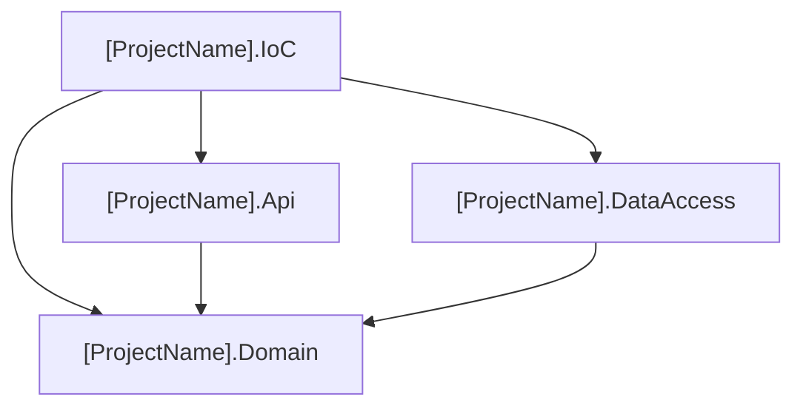

# AI Coding Standards & Project Specification

This document serves as the **Single Source of Truth** for AI Agents and Developers working on this solution. It combines Architectural Standards, Technology Choices, and strict Test Driven Development (TDD) protocols.

## 1. High-Level Architecture

All solutions must follow a **Clean Architecture** (Onion Architecture) style. The dependency flow is strictly unidirectional, pointing "inward" toward the Domain.

### Dependency Graph


### Component Responsibilities
1.  **[ProjectName].Domain** (The Core)
    *   **Role**: Entities, Value Objects, Logic, Commands, Queries, Repository Interfaces.
    *   **Dependencies**: NONE.
2.  **[ProjectName].DataAccess** (The Infrastructure)
    *   **Role**: Implements Repository Interfaces (Entity Framework/Dapper).
    *   **Dependencies**: Domain.
3.  **[ProjectName].Api** (The Presentation)
    *   **Role**: REST/HTTP Endpoints, Controllers, DTOs.
    *   **Dependencies**: Domain. (NO DataAccess reference).
4.  **[ProjectName].IoC** (The Composition Root)
    *   **Role**: `Program.cs`, Dependency Injection wiring.
    *   **Dependencies**: Api, DataAccess, Domain.

## 2. Technology Stack

*   **Framework**: .NET Standard / Latest LTS (.NET 8/10+)
*   **Language**: C# (Latest)
*   **Testing**: MSTest
*   **Assertions**: FluentAssertions
    *   **Rule**: Assert on Return Values or State Changes whenever possible.
    *   **Fallback**: Use `Received()` (interaction testing) ONLY for void methods where no state change or return value can be observed (e.g., logging, or the final boundary call).

### Dependencies Checklist
Ensure the following are installed/available before starting work:
1.  **MSTest.Sdk**: Core testing framework.
2.  **FluentAssertions**: For expressive assertions.
3.  **NSubstitute**: For mocking.
4.  **Microsoft.AspNetCore.App**: Framework Reference (Required for API Integration Tests).

## 3. Development Workflow: Test Driven Development (TDD)

**CRITICAL INSTRUCTION**: AI Agents must strictly adhere to the **Red/Green/Refactor** cycle. You are FORBIDDEN from writing implementation code without a verified failing test.

### Test Coverage Requirements
Every feature MUST cover the following scenarios (where applicable):
1.  **Happy Path**:
    *   **200 OK**: Request succeeded with data.
    *   **201 Created**: Resource successfully created.
    *   **204 No Content**: Action succeeded (Update/Delete).
2.  **Unhappy Paths (Error Handling)**:
    *   **400 Bad Request**: Validation failure (Invalid model, missing fields).
    *   **404 Not Found**: Resource does not exist (Get/Update/Delete).
    *   **500 Internal Server Error**: Unexpected downstream failures (Mocked Exception from Wrapper).

### Phase 1: RED (Write Test)
1.  **Goal**: Write a failing test for a specific behavior.
2.  **Action**: Create a test file following the [File Organization](#5-file-organization--naming-conventions) rules.
3.  **Best Practice**: Use **Randomized Data** via the `RandomTestValues` package instead of static constants or manual random calls.
    *   *Why?* Prevents "hardcoding" solutions (e.g., `return 0`) that accidentally pass static tests. It forces the implementation to handle dynamic input.
4.  **Run**: `dotnet test --filter <TestName>`.
5.  **Validation**:
    *   MUST fail.
    *   If logic is missing, write *stubs* (throw `NotImplementedException`) to make it compile, then confirm failure.

### Phase 2: GREEN (Simplest Implementation)
1.  **Goal**: Pass the test with the *minimum code necessary*.
2.  **Rule**: Do not implement full algorithms yet. If `Add(0,0)` expects `0`, return `0`.
    *   *Why?* To force the creation of the next test case.
3.  **Validation**: Run test. It must pass.

### Phase 3: REFACTOR
1.  **Goal**: Clean up code/tests without changing behavior.
2.  **Action**:
    *   **Clean Code Principles**: Use expressive variable names.
    *   **Comments**:
        *   **REQUIRED**: Use `// Arrange`, `// Act`, `// Assert` comments to clearly delineate test phases.
        *   **FORBIDDEN**: Avoid inline comments explaining *WHAT* or *WHY* (e.g., `// Using real instance...`). The code structure should be self-explanatory. Extract logic to private methods with descriptive names instead.
    *   **Structure**: Remove magic strings, extract methods. Use `TestBase` classes to reduce setup boilerplate.

### Phase 4: ITERATE
1.  **Goal**: Evolve logic by adding new test cases.
2.  **Action**: Add the next test case (e.g., `Add(1,1)` returns `2`).
    *   **Technique**: Use `[DataRow]`, `[TestCase]`, or similar attributes to modify existing tests or add new permutations efficiently.

### Mocking Rules & Isolation
*   **Architectural Rule**: The DataAccess layer must implement the **Repository Pattern** by using a **Wrapper Pattern** for the underlying store (e.g., `IMongoDbWrapper`, `ISqlWrapper`).
    *   *Reason*: Allows testing business logic with real Repository implementations but mocked low-level drivers.
*   **ALLOWED**: Mocking **Infrastructure Wrappers** (e.g., `IMongoDbWrapper`, `IHttpClientWrapper`, `IDateTimeWrapper`).
*   **FORBIDDEN**: Mocking **Domain Repository Interfaces** (e.g., `IStudentRepository`) in logical tests.
    *   *Correction*: When testing Commands/Queries, use the **REAL** Repository implementation injected with a **MOCKED** Wrapper.
*   **FORBIDDEN**: Mocking internal domain entities or value objects. Use real instances.

## 4. Design Patterns & Conventions

### CQRS (Command Query Responsibility Segregation)
*   **Commands (Write)**: `[ProjectName].Domain/Commands`. Return `Task`.
*   **Queries (Read)**: `[ProjectName].Domain/Queries`. Return `Task<T>`.
*   **Handlers**: Implement specific interfaces, inject Repository Interfaces.

### Centralized Dependency Injection
*   **No Magic in API**: `Program.cs` resides in **IoC** project.
*   **Registration**: `IoC` project coordinates `services.Add[LayerName]()` calls.

## 5. File Organization & Naming Conventions

### Directory Structure
```text
[SolutionName]/
├── [ProjectName].Api/          # Controllers, ApiConfig
├── [ProjectName].DataAccess/   # Repositories
├── [ProjectName].Domain/       # Commands, Queries, Entities, Interfaces
├── [ProjectName].IoC/          # Program.cs, RegisterDependencies
└── [ProjectName].Tests/        # MSTest Project
```

### Test File Granularity / Naming
To maintain context and clarity, use granular test files:
*   **Pattern**: `[ProjectName].Tests/[Namespace]/[ClassName]Tests/[MethodName]_[Scenario].cs`
*   **Example**:
    *   `Api/FooControllerTests/GetShould_ReturnOk.cs`
    *   `Api/FooControllerTests/GetShould_Throw_WhenInvalid.cs`
*   **Tip**: Use `partial class` for shared setup if splitting tests for the same method.

## 6. Instructions for AI Code Generation

**CRITICAL: ITERATIVE WORKFLOW REQUIRED**
*   **Small Steps**: Do NOT generate large amounts of code at once.
*   **Stop & Check**: After *every* file change or test run, pause and evaluate next steps.
*   **No "Overshooting"**: Do not anticipate future requirements. Solve ONLY the current failing test.
*   **Maintainability**: Enterprise-grade code requires careful adherence to patterns. Rushing breaks design.

When asked to implement a feature:
1.  **Check Context**: Do I understand the requirement?
2.  **Plan TDD**: What is the FIRST failing test?
3.  **Execute Cycle**:
    *   Create Test -> Run (Fail) -> Implement (Pass) -> Refactor.
    *   Repeat until feature is complete.
4.  **Conformity**: Ensure all new files land in the correct folders (Clean Architecture) and use specified namespaces.
