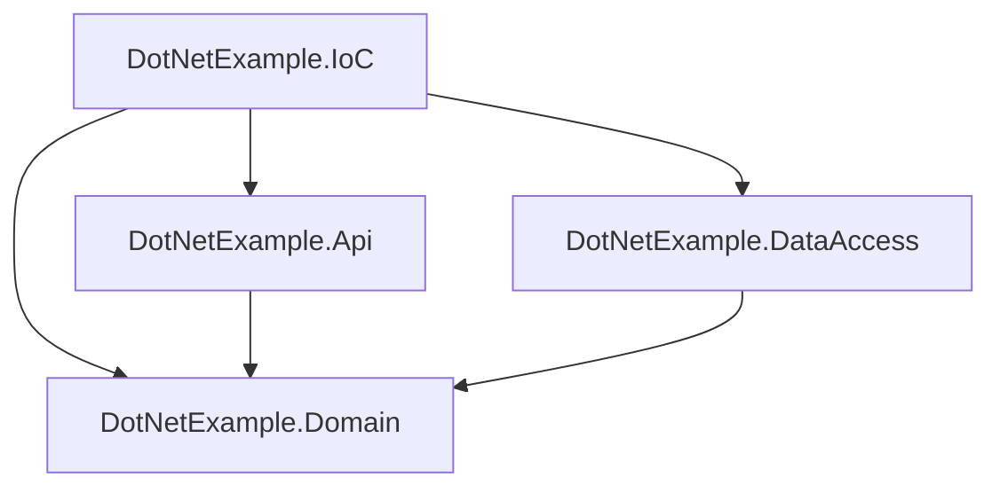

# DotNetExample

A reference .NET 10 Web API solution that serves as the standard template for new projects. It demonstrates **Clean Architecture** (Onion), **CQRS**, and a **centralized IoC** composition root, developed with strict **Test Driven Development**.

## Getting Started

Prerequisites: a .NET 10 SDK in the 10.0.1xx feature band. [`global.json`](global.json) pins it with `rollForward: latestPatch`: any 10.0.1xx patch works, but a newer feature band or major version (e.g. the .NET 11 SDK) is rejected, so every machine builds with the same compiler and analyzers. If `dotnet` reports "A compatible .NET SDK was not found", install it with `winget install Microsoft.DotNet.SDK.10`.

```bash
dotnet build DotNetExample.slnx
dotnet test DotNetExample.slnx
dotnet run --project DotNetExample.IoC
```

The executable is the **IoC** project, not the Api project. Swagger UI is enabled in the Development environment. Sample requests are in `DotNetExample.Api/DotNetExample.Api.http`.

## Using This Template

This repository is an example, so it deliberately has no CI pipeline. **A real project built from this template must add CI before its first feature.** The style rules and architecture tests only protect `main` if something runs them on every change. Locally, they're easy to skip.

At minimum, the pipeline should:

- **Run `dotnet build` and `dotnet test` on every pull request** and on every push to `main`.
- **Be a required status check** in branch protection, so a red build can't be merged.
- **Run on a schedule** (e.g. weekly) as well. `TreatWarningsAsErrors` turns a newly published NuGet security advisory into a build error, so a scheduled run catches it before it breaks an unrelated pull request.
- **Use the SDK pinned in `global.json`,** the same one developers use, so the analyzers behave the same everywhere. For example, `actions/setup-dotnet` with `global-json-file: global.json`.

## Architecture

Dependencies flow strictly inward toward the Domain.



| Project | Role | May reference |
|---|---|---|
| `DotNetExample.Domain` | Entities, value objects, logic, Commands, Queries, repository interfaces | Nothing |
| `DotNetExample.DataAccess` | Repository implementations, infrastructure wrappers | Domain |
| `DotNetExample.Api` | Controllers, DTOs, `ApiConfiguration.cs` (no `Program.cs`) | Domain |
| `DotNetExample.IoC` | `Program.cs` entry point, `RegisterDependencies.cs` DI wiring | Api, DataAccess, Domain |
| `DotNetExample.Tests` | MSTest unit tests (API tests over `WebApplicationFactory` with mocked wrappers) and architecture tests | Everything |
| `DotNetExample.IntegrationTests` | Wrapper contract tests against real dependencies | DataAccess |

### Directory Layout

```text
DotNetExample/
├── global.json                 # Pins the .NET SDK feature band
├── Directory.Build.props       # Shared build settings for every project
├── .editorconfig               # Style rules, enforced during build
├── DotNetExample.Api/
│   ├── Controllers/            # CarsController.cs (flat: one controller per feature)
│   ├── Models/Cars/            # Request/response DTOs
│   └── ApiConfiguration.cs
├── DotNetExample.DataAccess/
│   ├── Cars/                   # CarRepository.cs
│   └── Wrappers/               # Shared infrastructure wrappers (flat)
├── DotNetExample.Domain/
│   ├── Commands/Cars/          # AddCar, UpdateCar, DeleteCar
│   ├── Queries/Cars/           # GetCar, GetCars
│   ├── DataAccess/Cars/        # ICarRepository
│   ├── Entities/Cars/          # Car, Engine, TireSize, EngineShape
│   └── Exceptions/Cars/        # CarNotFoundException
├── DotNetExample.IoC/          # Program.cs, RegisterDependencies.cs
├── DotNetExample.Tests/
│   ├── Api/CarsControllerTests/  # One file per method: GetShould.cs, CreateShould.cs, …
│   └── Architecture/             # Convention rules: LayersShould.cs, HandlersShould.cs, …
└── DotNetExample.IntegrationTests/
    ├── Wrappers/                 # <Interface>Contract.cs + <Implementation>Should.cs
    └── Architecture/             # WrappersShould.cs: every wrapper has an integration test
```

Code is grouped into a folder per feature inside each layer, with namespaces matching the folders. See [Feature Folders](CONTRIBUTING.md#feature-folders).

## Technology

- .NET 10, C# latest, nullable reference types and implicit usings enabled
- `TreatWarningsAsErrors` and build-time `.editorconfig` enforcement in every project, via `Directory.Build.props`
- MSTest (`MSTest.Sdk`), NSubstitute, FluentAssertions, RandomTestValues
- ArchUnitNET for architecture tests
- Swashbuckle for Swagger
- `System.Text.Json` for JSON and Dapper for SQL (see [Preferred Libraries](CONTRIBUTING.md#preferred-libraries))

## Documentation

- [CONTRIBUTING.md](CONTRIBUTING.md) — architecture rules, design patterns, and the development workflow
- [TESTING.md](TESTING.md) — TDD protocol, coverage requirements, mocking rules, and test conventions
- [REVIEW.md](REVIEW.md) — code review checklist
