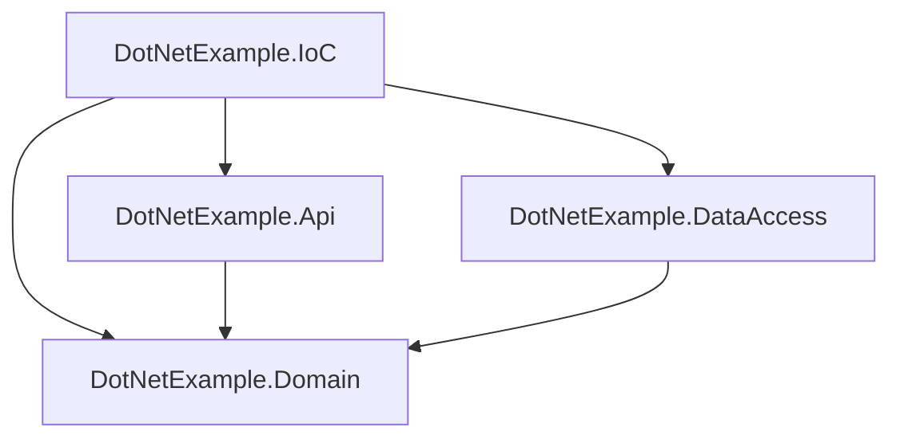

# DotNetExample

A reference .NET 10 Web API solution that serves as the standard template for new projects. It demonstrates **Clean Architecture** (Onion), **CQRS**, and a **centralized IoC** composition root, developed with strict **Test Driven Development**.

## Getting Started

Prerequisites: .NET 10 SDK.

```bash
dotnet build DotNetExample.slnx
dotnet test DotNetExample.slnx
dotnet run --project DotNetExample.IoC
```

The executable is the **IoC** project, not the Api project. Swagger UI is enabled in the Development environment. Sample requests are in `DotNetExample.Api/DotNetExample.Api.http`.

## Architecture

Dependencies flow strictly inward toward the Domain.



| Project | Role | May reference |
|---|---|---|
| `DotNetExample.Domain` | Entities, value objects, logic, Commands, Queries, repository interfaces | Nothing |
| `DotNetExample.DataAccess` | Repository implementations, infrastructure wrappers | Domain |
| `DotNetExample.Api` | Controllers, DTOs, `ApiConfiguration.cs` (no `Program.cs`) | Domain |
| `DotNetExample.IoC` | `Program.cs` entry point, `RegisterDependencies.cs` DI wiring | Api, DataAccess, Domain |
| `DotNetExample.Tests` | MSTest unit and integration tests | Api, Domain (DataAccess for integration tests if needed) |

### Directory Layout

```text
DotNetExample/
├── DotNetExample.Api/          # Controllers/, ApiConfiguration.cs
├── DotNetExample.DataAccess/   # Repositories, Wrappers/
├── DotNetExample.Domain/       # Commands/, Queries/, DataAccess/ (repository interfaces), Entities/
├── DotNetExample.IoC/          # Program.cs, RegisterDependencies.cs
└── DotNetExample.Tests/        # MSTest project
```

## Technology

- .NET 10, C# latest, nullable reference types and implicit usings enabled
- `TreatWarningsAsErrors` in every project
- MSTest (`MSTest.Sdk`), NSubstitute, FluentAssertions, RandomTestValues
- Swashbuckle for Swagger

## Documentation

- [CONTRIBUTING.md](CONTRIBUTING.md) — architecture rules, design patterns, and the development workflow
- [TESTING.md](TESTING.md) — TDD protocol, coverage requirements, mocking rules, and test conventions
- [REVIEW.md](REVIEW.md) — code review checklist
