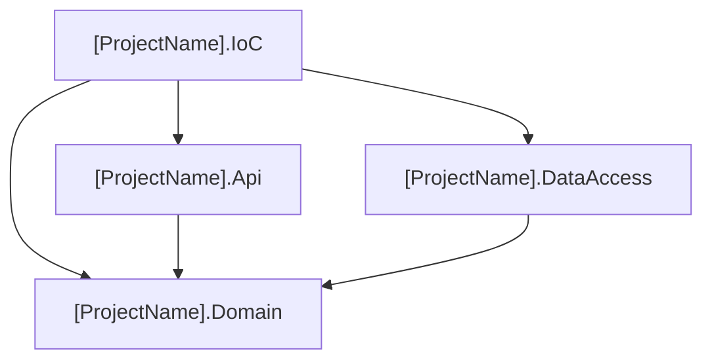

# General Project Specification and Standards

This document outlines the **Standard Architectural Template** for all future .NET projects. It defines a strict **Clean Architecture**, **CQRS**, and **Centralized IoC** structure that all new solutions must adhere to.

This specification is intended to be provided to LLMs or developers to ensure all projects share the same predictable structure.

## 1. High-Level Architecture

All solutions must follow a **Clean Architecture** (Onion Architecture) style. The dependency flow is strictly unidirectional, pointing "inward" toward the Domain.

### Dependency Graph Template


### Standard Projects (Components)
Every solution must contain the following specific projects:

1.  **[ProjectName].Domain** (The Core)
    -   **Responsibility**: Defines the Domain Model, Entities, Value Objects, Logic, and **Interfaces** (Ports).
    -   **Dependencies**: NONE (Clean Architecture rule). Must NOT reference DataAccess, Api, or external infrastructure packages.
    -   **Contents**: `Commands`, `Queries`, `Entities`, `RepositoryInterfaces`.

2.  **[ProjectName].DataAccess** (The Infrastructure)
    -   **Responsibility**: Implements the repository interfaces defined in Domain.
    -   **Dependencies**: References `[ProjectName].Domain`.
    -   **Technology**: typically Entity Framework Core or Dapper. This is an **Adapter** layer.

3.  **[ProjectName].Api** (The Presentation)
    -   **Responsibility**: Exposes the application via REST/HTTP.
    -   **Dependencies**: References `[ProjectName].Domain`. **MUST NOT** reference DataAccess.
    -   **Contents**: `Controllers`, `DTOs` (if separate from Commands), `ApiConfiguration.cs`.
    -   **Note**: This project does **NOT** contain `Program.cs`.

4.  **[ProjectName].IoC** (The Composition Root)
    -   **Responsibility**: Application Entry Point and Dependency Injection wiring.
    -   **Dependencies**: References **ALL** other projects (`Api`, `DataAccess`, `Domain`).
    -   **Contents**: `Program.cs` (Main entry), `RegisterDependencies.cs` (DI Container setup).

5.  **[ProjectName].Tests**
    -   **Responsibility**: Unit and Integration testing.
    -   **Dependencies**: References `Api` and `Domain` (and `DataAccess` for integration tests if needed).

## 2. Technology Standards

-   **Framework**: .NET Standard / Latest LTS (e.g., .NET 10.0+).
-   **Language**: C# (Latest).
-   **Testing Framework**: MSTest (via `MSTest.Sdk`) or project standard.
-   **Mocking**: NSubstitute.
-   **Build Configuration**:
    -   `Properties`: `<ImplicitUsings>enable</ImplicitUsings>`, `<Nullable>enable</Nullable>`.
    -   `Warnings`: `<TreatWarningsAsErrors>True</TreatWarningsAsErrors>`.

## 3. Design Patterns & Conventions

### CQRS (Command Query Responsibility Segregation)
All business logic is split into **Commands** (Writes) and **Queries** (Reads).
-   **Location**: `[ProjectName].Domain/Commands` and `[ProjectName].Domain/Queries`.
-   **Pattern**:
    -   **Command Class**: `VerbNoun` (e.g., `UpdateUser`). Implements a domain interface.
    -   **Dependency**: Inject Repository Interfaces via constructor.
    -   **Return**: `Task` or `Task<TResult>`.

### Centralized Dependency Injection
-   **No Magic in API**: The standard Web API template's `Program.cs` is moved to the `IoC` project.
-   **Registration**: `IoC` project orchestrates the `IServiceCollection`.
    -   Layers may expose `services.Add[LayerName]()` extension methods.
    -   `IoC` calls these extensions to compose the final application.

### Naming Conventions
-   **Tests**: `Feature_State_Expectation` (e.g., `User_WhenInvalidEmail_ShouldThrow`).
-   **Interfaces**: PascalCase, prefixed with `I` (e.g., `IUserRepository`).
-   **Async**: All async methods must end with `Async` (e.g., `GetByIdAsync`).

## 4. Directory Structure Template

```text
[SolutionName]/
├── [ProjectName].Api/          # Presentation
│   ├── Controllers/
│   └── ApiConfiguration.cs     # Extensions for services.AddApi()
├── [ProjectName].DataAccess/   # Infrastructure
│   ├── Repositories/           # Implementation of Domain Interfaces
│   └── [ProjectName].DataAccess.csproj
├── [ProjectName].Domain/       # CORE LOGIC
│   ├── Commands/               # CQRS Write Handlers
│   ├── Queries/                # CQRS Read Handlers
│   ├── DataAccess/             # Repository Interfaces (Ports)
│   ├── Entities/               # Domain Models
│   └── [ProjectName].Domain.csproj
├── [ProjectName].IoC/          # ENTRY POINT
│   ├── Program.cs              # Main(string[] args)
│   ├── RegisterDependencies.cs # DI Container Wiring
│   └── [ProjectName].IoC.csproj
└── [ProjectName].Tests/        # Testing
    └── [ProjectName].Tests.csproj
```

## 5. Instructions for LLM Code Generation

When generating a **NEW** project or adding to an **EXISTING** one following this standard:
1.  **Strictly** adhere to the IoC-as-Entry-Point pattern. Do not put `Program.cs` in the API project.
2.  **Verify** dependencies: Ensure Domain never references outer layers.
3.  **Clean Code**: Always use `Nullable` reference types and treat warnings as errors.
4.  **Testing**: Always generate a corresponding test file for any new Logic/Command/Query.
